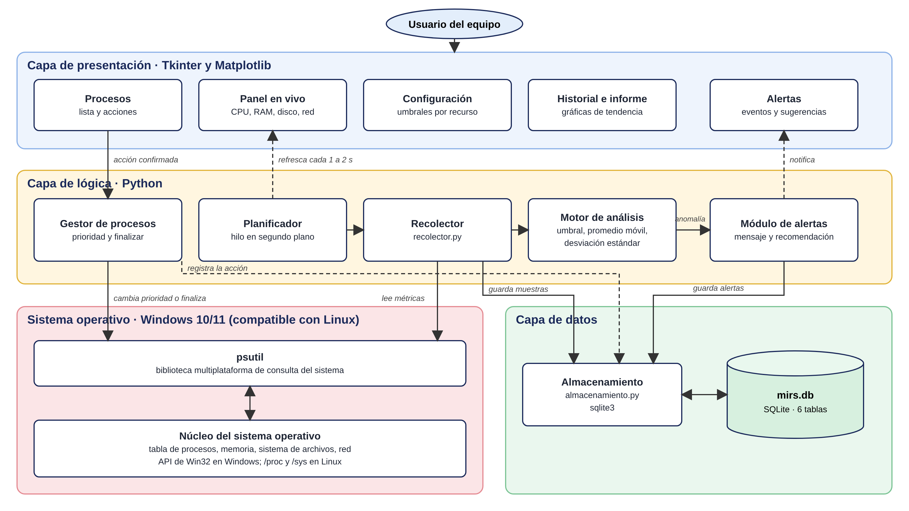
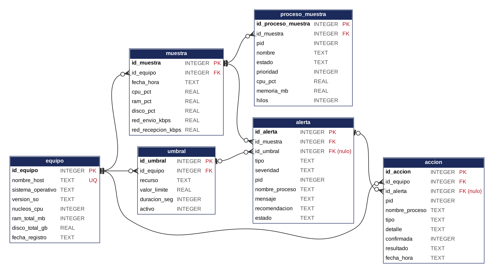

# MIRS: Monitor Inteligente de Recursos del Sistema

Aplicación de escritorio que vigila en tiempo real el uso de CPU, memoria, disco y red de un equipo con Windows, identifica los procesos que más recursos consumen, detecta comportamientos anómalos comparando el consumo actual con el historial y avisa al usuario con alertas y recomendaciones.

Proyecto de aula (ABP) de la asignatura **Sistemas Operativos**, Ingeniería de Software, Universidad Manuela Beltrán, Bogotá, 2026. Grupo 2.

| | |
|---|---|
| Autores | Gustavo Adolfo Cardona Bayona · Jonathan Soler Guevara · Sebastián Torrez Florez |
| Lenguaje | Python 3.10 o superior |
| Plataforma | Windows 10/11 (el núcleo de lectura también funciona en Linux) |
| Estado | Entrega 2: estructura del prototipo, versión 0.1.0 |

## Contexto

Un equipo de oficina o de estudio se vuelve lento y quien lo usa casi nunca sabe por qué. El Administrador de tareas de Windows muestra el consumo del momento, pero no guarda lo que pasó hace diez minutos, no distingue un pico pasajero de un consumo sostenido y no avisa: hay que abrirlo y mirarlo justo cuando ocurre el problema. Cuando por fin se revisa, la causa suele haber desaparecido, o la única salida que queda es reiniciar.

MIRS responde a esa situación con tres ideas: **monitorear** de forma continua, **analizar** el consumo frente al historial del propio equipo y **alertar** a tiempo con una recomendación concreta. Desde la asignatura, el proyecto sirve para observar en un equipo real los conceptos de procesos e hilos, estados de un proceso, planificación y prioridades, gestión de memoria y sistema de archivos.

## Qué hace

1. Muestra en un panel el porcentaje de uso de CPU, RAM y disco, y el tráfico de red, actualizado cada 1 a 2 segundos.
2. Lista los procesos activos con PID, nombre, estado, prioridad, uso de CPU, memoria y número de hilos.
3. Permite configurar un umbral por recurso (por ejemplo, CPU sobre 85 % durante 60 segundos).
4. Detecta anomalías: consumo sostenido sobre el umbral, valores que se alejan del comportamiento habitual del equipo y procesos cuya memoria crece sin liberarse.
5. Genera alertas con severidad y una recomendación para el usuario.
6. Finaliza un proceso o cambia su prioridad, siempre con confirmación previa, y deja registro de la acción.
7. Guarda el historial en una base de datos local y lo muestra en gráficas de tendencia y en un informe resumen.

### Alcance

**Incluye:** monitoreo de un solo equipo local; visualización en tiempo real; detección por umbrales y por análisis estadístico simple; alertas, recomendaciones y acciones básicas con confirmación; historial e informe; pruebas y manual de usuario.

**No incluye:** monitoreo remoto de varios equipos, modelos de aprendizaje automático entrenados, modificación del núcleo o de controladores, funciones de antivirus y versiones web o móviles.

## Cómo detecta las anomalías

El "inteligente" del nombre se refiere a que MIRS no se limita a comparar contra un número fijo; también aprende cuál es el comportamiento normal del equipo a partir de sus propias muestras.

| Regla | Qué compara | Severidad |
|---|---|---|
| Umbral sostenido | El recurso supera el límite configurado durante el tiempo configurado | ALTA |
| Desviación del historial | El valor actual se aleja más de tres desviaciones estándar del promedio móvil de las últimas muestras | MEDIA |
| Posible fuga de memoria | La memoria de un mismo proceso crece en muestras consecutivas sin bajar | MEDIA |

Las tres reglas usan estadística descriptiva (promedio móvil y desviación estándar); el proyecto no entrena modelos de aprendizaje automático.

## Arquitectura

La aplicación se organiza en tres capas sobre el sistema operativo. La interfaz (Tkinter y Matplotlib) nunca lee el sistema directamente: un hilo en segundo plano toma las muestras, las analiza y las guarda, y la interfaz se refresca con esos datos.



| Módulo | Archivo | Estado |
|---|---|---|
| Recolector de métricas | `src/mirs/recolector.py` | Implementado |
| Almacenamiento | `src/mirs/almacenamiento.py` | Implementado |
| Configuración | `src/mirs/config.py` | Implementado |
| Planificador de muestreo | `src/mirs/planificador.py` | Siguiente entrega |
| Motor de análisis | `src/mirs/analizador.py` | Siguiente entrega |
| Módulo de alertas | `src/mirs/alertas.py` | Siguiente entrega |
| Gestor de procesos | `src/mirs/gestor_procesos.py` | Siguiente entrega |
| Interfaz gráfica | `src/mirs/interfaz/` | Siguiente entrega (mockups en `docs/mockups`) |

El recolector usa **psutil**, que obtiene los datos del núcleo a través de la API de Win32 en Windows y de `/proc` y `/sys` en Linux. El uso de CPU de cada proceso se calcula entre dos lecturas y se divide por el número de núcleos para que quede entre 0 y 100 %.

## Base de datos

SQLite, en el archivo `datos/mirs.db`, que se crea solo al ejecutar el prototipo. El esquema completo está en [`database/schema.sql`](database/schema.sql).



| Tabla | Guarda | Relación |
|---|---|---|
| `equipo` | Datos fijos del equipo (host, sistema operativo, núcleos, RAM, disco) | Tabla principal |
| `umbral` | Límite y duración por recurso | Un equipo tiene cero o muchos umbrales, uno por recurso |
| `muestra` | Uso global de CPU, RAM, disco y red en un instante | Un equipo tiene cero o muchas muestras |
| `proceso_muestra` | Los procesos de mayor consumo en cada muestra | Una muestra tiene cero o muchos procesos |
| `alerta` | Anomalía detectada, mensaje, recomendación y estado | Una muestra origina cero o muchas alertas; un umbral, cero o muchas |
| `accion` | Acción confirmada sobre un proceso y su resultado | Un equipo registra cero o muchas acciones; una alerta puede originar cero o muchas |

Las reglas de integridad se aplican en la propia base de datos: llaves foráneas activadas, `CHECK` para porcentajes entre 0 y 100 y para los valores permitidos de tipo, severidad y estado, y `UNIQUE (id_equipo, recurso)` en los umbrales. Cada muestra se guarda junto con sus procesos en una sola transacción: si algo falla, no queda una muestra a medias. La base trabaja en modo WAL para que la interfaz pueda leer mientras el hilo de muestreo escribe.

## Tecnologías

| Tecnología | Uso |
|---|---|
| Python 3.10+ | Lenguaje del proyecto |
| psutil | Lectura de CPU, memoria, disco, red y procesos |
| Tkinter (ttk) | Interfaz gráfica de escritorio, incluida en Python |
| Matplotlib | Gráficas de tendencia dentro de la interfaz |
| SQLite 3 (`sqlite3`) | Historial local, sin servidor |
| threading | Hilo de muestreo en segundo plano |
| unittest | Pruebas automáticas |
| Git y GitHub | Control de versiones |
| Visual Studio Code | Entorno de desarrollo |

## Estructura del repositorio

```
MIRS_SISTEMASOPERATIVOS_G2/
├── src/mirs/              código del prototipo
│   ├── __main__.py        prueba de consola: toma muestras y las guarda
│   ├── config.py          intervalo, ruta de la base de datos y umbrales iniciales
│   ├── recolector.py      lectura del sistema con psutil
│   └── almacenamiento.py  acceso a SQLite
├── database/schema.sql    esquema de las seis tablas
├── tests/                 pruebas unitarias
├── datos/                 aquí se crea mirs.db (no se versiona)
├── docs/
│   ├── ficha/             ficha técnica (Entrega 1)
│   ├── diagramas/         arquitectura y modelo relacional (fuente y PNG)
│   ├── mockups/           pantallas propuestas de la interfaz (HTML y PNG)
│   └── Entrega2_*.docx/pdf documento de la Entrega 2
├── requirements.txt
└── README.md
```

## Instalación y ejecución (Windows, PowerShell)

```powershell
git clone https://github.com/gustavo8015/MIRS_SISTEMASOPERATIVOS_G2.git
cd MIRS_SISTEMASOPERATIVOS_G2
python -m venv .venv
.venv\Scripts\Activate.ps1
pip install -r requirements.txt

$env:PYTHONPATH = "src"
python -m mirs --muestras 5          # toma 5 muestras, las imprime y las guarda en datos\mirs.db
```

Opciones: `--intervalo 2` (segundos entre muestras) y `--bd ruta\archivo.db`. Algunos procesos del sistema pertenecen a otro usuario; psutil no puede leerlos sin permisos de administrador y el recolector los omite sin detenerse.

## Pruebas

```powershell
python -m unittest discover -s tests -v
```

Diez pruebas cubren el recolector (rangos válidos de CPU, RAM y disco, orden y límite de la lista de procesos) y el almacenamiento (creación de las seis tablas, equipo sin duplicados, un umbral por recurso, llave foránea, `CHECK` de porcentajes y transacción que no deja procesos huérfanos).

## Hoja de ruta

| Entrega | Contenido | Estado |
|---|---|---|
| 1 | Ficha técnica del proyecto | Entregada |
| 2 | Levantamiento de información, descripción, estructura del prototipo y tecnologías | Esta versión |
| 3 | Planificador de muestreo, motor de análisis y alertas | Pendiente |
| 4 | Interfaz Tkinter completa, gestor de procesos e informe | Pendiente |
| 5 | Pruebas finales, manual de usuario y sustentación | Pendiente |

## Convención de commits

Los mensajes siguen [Conventional Commits](https://www.conventionalcommits.org/es/v1.0.0/) en español: `tipo(ámbito): descripción`. Tipos usados: `feat` (funcionalidad), `fix` (corrección), `docs` (documentación), `test` (pruebas), `chore` (estructura y configuración). Cada módulo nuevo se trabaja en una rama `feature/<módulo>` y se integra a `main` cuando sus pruebas pasan.

## Documentación

- [Ficha técnica (Entrega 1)](docs/ficha/Entrega1_Microproyecto_MIRS.png)
- [Mockups de la interfaz](docs/mockups/)
- Documento de la Entrega 2: [Word](docs/Entrega2_Estructura_Prototipo_MIRS.docx) · [PDF](docs/Entrega2_Estructura_Prototipo_MIRS.pdf)
