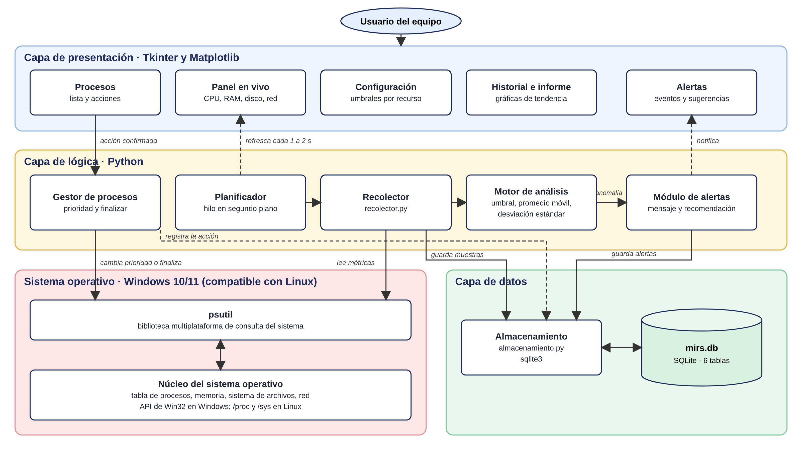
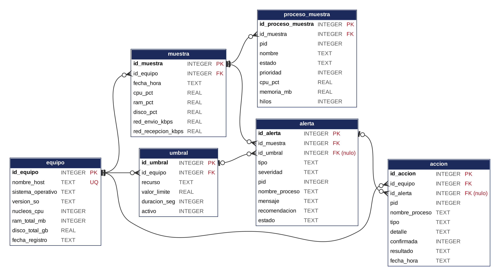

# MIRS: Monitor Inteligente de Recursos del Sistema

Aplicación de escritorio que vigila en tiempo real el uso de CPU, memoria, disco y red de un equipo con Windows, identifica los procesos que más recursos consumen, detecta comportamientos anómalos comparando el consumo actual con el historial y avisa al usuario con alertas y recomendaciones. Incluye **MIRS Móvil**, una app Android que muestra en el celular el estado del PC y sus alertas.

Proyecto de aula (ABP) de la asignatura **Sistemas Operativos**, Ingeniería de Software, Universidad Manuela Beltrán, Bogotá, 2026. Grupo 2.

| | |
|---|---|
| Autores | Gustavo Adolfo Cardona Bayona · Jonathan Soler Guevara · Sebastián Torrez Florez |
| Lenguaje | Python 3.10 o superior (PC) y Java (app Android) |
| Plataforma | Windows 10/11 (el núcleo de lectura también funciona en Linux); app para Android 8.0 o superior |
| Estado | Versión 0.6.0: monitoreo continuo, alertas, API, app móvil, búsqueda de equipos e instalador para Windows |

## Contexto

Un equipo de oficina o de estudio se vuelve lento y quien lo usa casi nunca sabe por qué. El Administrador de tareas de Windows muestra el consumo del momento, pero no guarda lo que pasó hace diez minutos, no distingue un pico pasajero de un consumo sostenido y no avisa: hay que abrirlo y mirarlo justo cuando ocurre el problema. Cuando por fin se revisa, la causa suele haber desaparecido, o la única salida que queda es reiniciar.

MIRS responde a esa situación con tres ideas: **monitorear** de forma continua, **analizar** el consumo frente al historial del propio equipo y **alertar** a tiempo con una recomendación concreta. Desde la asignatura, el proyecto sirve para observar en un equipo real los conceptos de procesos e hilos, estados de un proceso, planificación y prioridades, gestión de memoria y sistema de archivos.

## Qué hace

1. Muestra en un panel el porcentaje de uso de CPU, RAM y disco, y el tráfico de red, actualizado cada 1 a 2 segundos.
2. Lista los procesos activos con PID, nombre, estado, prioridad, uso de CPU, memoria y número de hilos.
3. Permite configurar un umbral por recurso (por ejemplo, CPU sobre 85 % durante 60 segundos).
4. Detecta anomalías: consumo sostenido sobre el umbral, valores que se alejan del comportamiento habitual del equipo y procesos cuya memoria crece sin liberarse.
5. Genera alertas con severidad y una recomendación para el usuario.
6. Finaliza un proceso o cambia su prioridad, siempre con confirmación previa, y deja registro de la acción.
7. Guarda el historial en una base de datos local y lo muestra en gráficas de tendencia y en un informe resumen.

### Alcance

**Incluye:** monitoreo de un solo equipo local; visualización en tiempo real; detección por umbrales y por análisis estadístico simple; alertas, recomendaciones y acciones básicas con confirmación; historial e informe; una app Android de consulta que muestra el panel, los procesos y las alertas del PC; pruebas y manual de usuario.

**No incluye:** monitoreo remoto de varios equipos, modelos de aprendizaje automático entrenados, modificación del núcleo o de controladores, funciones de antivirus, acciones sobre procesos desde el celular, monitoreo del propio celular ni versión web.

## Cómo detecta las anomalías

El "inteligente" del nombre se refiere a que MIRS no se limita a comparar contra un número fijo; también aprende cuál es el comportamiento normal del equipo a partir de sus propias muestras.

| Regla | Qué compara | Severidad |
|---|---|---|
| Umbral sostenido | El recurso supera el límite configurado durante el tiempo configurado | ALTA |
| Desviación del historial | El valor actual se aleja más de tres desviaciones estándar del promedio móvil de las últimas muestras | MEDIA |
| Posible fuga de memoria | La memoria de un mismo proceso crece en muestras consecutivas sin bajar | MEDIA |

Las tres reglas usan estadística descriptiva (promedio móvil y desviación estándar); el proyecto no entrena modelos de aprendizaje automático.

## Arquitectura

La aplicación se organiza en tres capas sobre el sistema operativo. La interfaz (Tkinter y Matplotlib) nunca lee el sistema directamente: un hilo en segundo plano toma las muestras, las analiza y las guarda, y la interfaz se refresca con esos datos.



| Módulo | Archivo | Estado |
|---|---|---|
| Recolector de métricas | `src/mirs/recolector.py` | Implementado |
| Almacenamiento | `src/mirs/almacenamiento.py` | Implementado |
| Configuración | `src/mirs/config.py` | Implementado |
| Planificador de muestreo | `src/mirs/planificador.py` | Implementado |
| Motor de análisis y alertas | `src/mirs/analizador.py` | Implementado (las tres reglas) |
| Servidor y API para la app | `src/mirs/servidor.py` | Implementado |
| App móvil (MIRS Móvil) | `android/` | Implementada |
| Gestor de procesos | `src/mirs/gestor_procesos.py` | Siguiente entrega |
| Interfaz gráfica | `src/mirs/interfaz/` | Siguiente entrega (mockups en `docs/mockups`) |

El recolector usa **psutil**, que obtiene los datos del núcleo a través de la API de Win32 en Windows y de `/proc` y `/sys` en Linux. El uso de CPU de cada proceso se calcula entre dos lecturas y se divide por el número de núcleos para que quede entre 0 y 100 %.

## App móvil: MIRS Móvil

App Android escrita en Java que muestra en el celular lo que pasa en el PC. No lee el celular: consulta cada 2 segundos la API que publica el servidor de MIRS en el PC.

```
Celular / emulador  --HTTP-->  servidor.py (PC)  -->  mirs.db (SQLite)
   MIRS Móvil                 hilo de muestreo + API      historial y alertas
```

| Pestaña | Qué muestra |
|---|---|
| Panel | Chip 3D que gira según el uso de CPU dentro de un anillo animado; anillos de RAM, disco y red; alerta con pulso; gráfica en vivo de 5 minutos con umbral y lectura al tocar; mapa de calor de los núcleos lógicos; procesos de mayor consumo |
| Procesos | Procesos de la última muestra con PID, estado, prioridad, hilos, CPU y memoria; búsqueda por nombre o PID |
| Alertas | Alertas activas o todas, con severidad, mensaje y recomendación; botones para marcarlas como atendidas o descartarlas |

Por red la app llega al PC con HTTP; por Bluetooth, con RFCOMM (ver más abajo). La app es de consulta: no finaliza procesos ni cambia prioridades, porque esas acciones requieren confirmación frente al equipo. La única escritura es el estado de una alerta.

**Diseño.** Tema oscuro tipo centro de control con tarjetas translúcidas y barra de navegación flotante. Las animaciones (anillos que se llenan, cifras que suben como contador, transición entre pestañas, pulso de alerta, vibración corta al llegar una alerta nueva) respetan la opción de Android de reducir animaciones. El chip es un modelo 3D propio (`Chip3DView`): rota los vértices, los proyecta con perspectiva, descarta las caras ocultas, las ordena de la más lejana a la más cercana y las sombrea con una luz direccional; se puede girar con el dedo. El mapa de núcleos muestra cómo el planificador del sistema operativo reparte la carga. Todo se dibuja con `Canvas`, sin librerías externas.

Al igual que la interfaz del PC, la app separa la red de la pantalla: las consultas corren en un hilo aparte (`ExecutorService`) y los resultados se pintan en el hilo principal (`Handler`). La gráfica se dibuja con `Canvas`, sin librerías externas.

### API del servidor

| Método y ruta | Respuesta |
|---|---|
| `GET /api/estado` | Equipo, última muestra, uso de CPU por núcleo (`nucleos`), 5 procesos de mayor consumo y número de alertas activas |
| `GET /api/muestras?cantidad=150` | Historial reciente en orden cronológico |
| `GET /api/procesos` | Procesos de la última muestra |
| `GET /api/alertas?estado=ACTIVA` | Alertas activas (`estado=TODAS` para todas) |
| `GET /api/umbrales` | Umbrales configurados |
| `POST /api/alertas/<id>` | Cuerpo `{"estado": "ATENDIDA"}` o `{"estado": "DESCARTADA"}` |

El servidor usa solo la biblioteca estándar de Python (`http.server`). No tiene autenticación: por defecto escucha únicamente en el propio PC (127.0.0.1), que es lo que necesita el emulador; la opción `--lan` lo abre a la red para otros equipos y celulares.

### Conexión por Bluetooth

La app también puede ver un portátil sin red, directamente por Bluetooth clásico (RFCOMM, perfil de puerto serie SPP). Windows publica ese perfil como un **puerto COM entrante**; el servidor de MIRS lo atiende con pyserial y responde lo mismo que la API HTTP. Cada petición viaja como una línea (`GET /api/estado`) y cada respuesta como otra (`200 {json}`).

```
Celular  --Bluetooth RFCOMM (SPP)-->  COM entrante de Windows  -->  bluetooth.py  -->  API local
```

Requiere un **celular Android real**: el emulador de Android Studio no tiene Bluetooth.

1. **Emparejar.** Puede hacerlo desde la app (paso 4) o desde la configuración de Bluetooth de Windows.
2. **Crear el puerto COM entrante (una sola vez).** En Windows: Configuración, Bluetooth y dispositivos, Dispositivos, **Más opciones de Bluetooth**, pestaña **Puertos COM**, **Agregar**, elegir **Entrante** y Aceptar. Windows asigna el número solo; no hace falta anotarlo.
3. **Iniciar el servidor.** Abra `MIRS_Servidor.exe` con doble clic: busca solo el puerto COM entrante de Bluetooth, y si se crea después de abrirlo lo detecta en unos segundos sin reiniciar. Con Python:

   ```powershell
   python -m mirs.servidor --bluetooth          # busca solo el puerto entrante
   python -m mirs.servidor --bluetooth COM5     # o fija uno
   ```

   Debe mostrar `Bluetooth: puerto entrante detectado: COMx` y luego `Bluetooth: esperando la app en COMx`. Para abrir el `.exe` sin Bluetooth: `MIRS_Servidor.exe --sin-bluetooth`.

   **Cómo detecta el puerto:** en Windows el identificador de cada puerto COM de Bluetooth termina con la dirección del dispositivo remoto. El puerto entrante no tiene dispositivo remoto, así que su dirección es `000000000000`; el servidor elige ese y descarta los salientes.
4. **Conectar desde la app.** Toque el ícono de Bluetooth del encabezado y conceda el permiso de dispositivos cercanos. La app busca los dispositivos Bluetooth cercanos: muestra primero los emparejados, marca los computadores y va agregando los que encuentra. Si el portátil no está emparejado, al tocarlo la app lo empareja (acepte el código en el celular y en el portátil) y se conecta. El subtítulo mostrará `· Bluetooth` y la app recordará la conexión.

   Para que el portátil aparezca en la búsqueda, deje abierta en Windows la página **Bluetooth y dispositivos** o active **Permitir que los dispositivos Bluetooth encuentren este equipo** en Más opciones de Bluetooth. En Android 11 o anterior la búsqueda también necesita la ubicación activada.

Si el portátil no aparece en la lista, revise que esté visible (paso 4). Si aparece pero no conecta, revise que el servidor muestre las líneas del paso 3.

### Búsqueda de equipos

El botón de lupa de la app (**Buscar equipos**) encuentra los PC que tienen el servidor abierto, sin escribir la IP:

1. Prueba `http://10.0.2.2:8765`, que en el emulador es el PC donde corre Android Studio.
2. Envía por difusión UDP el mensaje `MIRS_BUSCAR` al puerto 8766 de toda la red. Cada servidor abierto en modo red (`--lan` o `MIRS_Servidor.exe`) responde con su nombre, su sistema operativo y su puerto.
3. Muestra la lista y, al tocar un equipo, la app se conecta a él y recuerda la dirección.

Las redes de universidades y empresas suelen bloquear la difusión o la comunicación entre equipos. En ese caso la búsqueda no encuentra nada y la dirección se escribe a mano con el botón de servidor.

## Base de datos

SQLite, en el archivo `datos/mirs.db`, que se crea solo al ejecutar el prototipo. El esquema completo está en [`database/schema.sql`](database/schema.sql).



| Tabla | Guarda | Relación |
|---|---|---|
| `equipo` | Datos fijos del equipo (host, sistema operativo, núcleos, RAM, disco) | Tabla principal |
| `umbral` | Límite y duración por recurso | Un equipo tiene cero o muchos umbrales, uno por recurso |
| `muestra` | Uso global de CPU, RAM, disco y red en un instante | Un equipo tiene cero o muchas muestras |
| `proceso_muestra` | Los procesos de mayor consumo en cada muestra | Una muestra tiene cero o muchos procesos |
| `alerta` | Anomalía detectada, mensaje, recomendación y estado | Una muestra origina cero o muchas alertas; un umbral, cero o muchas |
| `accion` | Acción confirmada sobre un proceso y su resultado | Un equipo registra cero o muchas acciones; una alerta puede originar cero o muchas |

Las reglas de integridad se aplican en la propia base de datos: llaves foráneas activadas, `CHECK` para porcentajes entre 0 y 100 y para los valores permitidos de tipo, severidad y estado, y `UNIQUE (id_equipo, recurso)` en los umbrales. Cada muestra se guarda junto con sus procesos en una sola transacción: si algo falla, no queda una muestra a medias. La base trabaja en modo WAL para que la interfaz pueda leer mientras el hilo de muestreo escribe.

## Tecnologías

| Tecnología | Uso |
|---|---|
| Python 3.10+ | Lenguaje del proyecto |
| psutil | Lectura de CPU, memoria, disco, red y procesos |
| Tkinter (ttk) | Interfaz gráfica de escritorio, incluida en Python |
| Matplotlib | Gráficas de tendencia dentro de la interfaz |
| SQLite 3 (`sqlite3`) | Historial local, sin servidor |
| threading | Hilo de muestreo en segundo plano |
| http.server | API JSON para la app móvil, sin dependencias externas |
| pyserial | Puerto COM entrante de Bluetooth (RFCOMM) para atender a la app sin red |
| Android (Java), AndroidX y Material Components | App móvil, compilada con Android Studio (Gradle 8.7, AGP 8.5.2, minSdk 26) |
| unittest | Pruebas automáticas |
| Git y GitHub | Control de versiones |
| Visual Studio Code | Entorno de desarrollo |

## Estructura del repositorio

```
MIRS_SISTEMASOPERATIVOS_G2/
├── src/mirs/              código del prototipo
│   ├── __main__.py        prueba de consola: toma muestras y las guarda
│   ├── config.py          intervalo, ruta de la base de datos y umbrales iniciales
│   ├── recolector.py      lectura del sistema con psutil
│   ├── almacenamiento.py  acceso a SQLite
│   ├── analizador.py      reglas de detección de anomalías
│   ├── planificador.py    hilo de muestreo en segundo plano
│   ├── servidor.py        monitoreo continuo y API para la app móvil
│   └── bluetooth.py       puente Bluetooth (puerto COM entrante, RFCOMM)
├── android/               app MIRS Móvil (proyecto de Android Studio)
├── mirs_servidor.py       punto de entrada de MIRS_Servidor.exe
├── scripts/
│   ├── windows/           PowerShell 01 a 11: entorno, instalación, usuarios, tarea, firewall,
│   │                      seguridad, respaldo, monitoreo, vigilante, pruebas y auditoría
│   └── linux/             Bash: instalación como servicio systemd y pruebas
├── config/                mirs-windows.psd1 (parámetros de los scripts) y mirs.service (systemd)
├── evidencias/            salidas reales de los scripts en Windows Server 2025 y Ubuntu
├── .github/workflows/     construcción del .exe y ejecución de los scripts de administración
├── database/schema.sql    esquema de las seis tablas
├── tests/                 pruebas unitarias
├── datos/                 aquí se crea mirs.db (no se versiona)
├── docs/
│   ├── ficha/             ficha técnica (Entrega 1)
│   ├── diagramas/         arquitectura y modelo relacional (fuente y PNG)
│   ├── mockups/           pantallas propuestas de la interfaz (HTML y PNG)
│   ├── Entrega2_*.docx/pdf documento de la Entrega 2
│   └── Documento_Tecnico_Final_*.docx/pdf  documento técnico final
├── requirements.txt
└── README.md
```

## Instalación y ejecución (Windows, PowerShell)

```powershell
git clone https://github.com/gustavo8015/MIRS_SISTEMASOPERATIVOS_G2.git
cd MIRS_SISTEMASOPERATIVOS_G2
python -m venv .venv
.venv\Scripts\Activate.ps1
pip install -r requirements.txt

$env:PYTHONPATH = "src"
python -m mirs --muestras 5          # toma 5 muestras, las imprime y las guarda en datos\mirs.db
```

Opciones: `--intervalo 2` (segundos entre muestras) y `--bd ruta\archivo.db`. Algunos procesos del sistema pertenecen a otro usuario; psutil no puede leerlos sin permisos de administrador y el recolector los omite sin detenerse.

### Instalar en otros computadores (sin Python)

Cada PC que se quiera monitorear necesita su propio servidor, porque es el que lee su CPU, su memoria y sus procesos.

1. Descargue `MIRS_Servidor.exe` desde la sección **Releases** de este repositorio.
2. Ábralo con doble clic. Se abre una ventana que monitorea el PC cada 2 segundos y muestra su dirección en la red. Déjela abierta.
3. Si aparece **"Windows protegió su PC"**, elija **Más información** y **Ejecutar de todas formas**: el programa no tiene firma digital. Si el firewall pregunta, permita el acceso en **redes privadas**.
4. En la app, toque **Buscar equipos** o escriba `http://IP-del-PC:8765`.

El historial de ese PC queda en la carpeta `datos` junto al `.exe`. En equipos con **Smart App Control** activado, Windows puede bloquear el `.exe` porque no tiene firma; ahí use el servidor de Python (`python -m mirs.servidor --lan`).

El `.exe` lo construye GitHub Actions en una máquina Windows (`.github/workflows/servidor-windows.yml`): ejecuta las pruebas, empaqueta con PyInstaller, arranca el `.exe` para comprobar que responde y, cuando se crea una etiqueta `vX.Y.Z`, lo publica en Releases. Para construirlo a mano en Windows:

```powershell
pip install psutil pyinstaller
pyinstaller --onefile --name MIRS_Servidor --paths src --add-data "database/schema.sql;database" --collect-submodules mirs mirs_servidor.py
```

### Servidor y app móvil

1. **Inicie el servidor en el PC** y deje la ventana abierta:

   ```powershell
   $env:PYTHONPATH = "src"
   python -m mirs.servidor              # monitorea cada 2 s y publica la API en el puerto 8765
   ```

   Debe mostrar `API en http://127.0.0.1:8765/api/estado`. Puede comprobarlo abriendo esa dirección en el navegador.
2. **Abra la app en Android Studio:** File, Open y elija la carpeta `android`. Espere a que termine la sincronización de Gradle (la primera vez descarga Gradle 8.7 y las dependencias). Si pregunta por el Gradle JDK, use el JDK 17 incluido.
3. **Ejecute la app** en el emulador con el botón Run. La app usa por defecto `http://10.0.2.2:8765`, la dirección con la que el emulador llega al PC.
4. **Celular físico u otro PC** en la misma red: inicie el servidor con `python -m mirs.servidor --lan` (o abra `MIRS_Servidor.exe`) y en la app toque **Buscar equipos**. Si no lo encuentra, toque el ícono de servidor y escriba la dirección que muestra la ventana del servidor, por ejemplo `http://192.168.1.25:8765`. Windows puede pedir permiso en el firewall.

Para ver una alerta en la demostración, baje temporalmente el umbral de CPU en la tabla `umbral` (por ejemplo a 30 % y 10 s) o ponga el equipo bajo carga.

## Administración en Windows (instalación permanente)

Los scripts de `scripts/windows` dejan MIRS instalado como lo haría un administrador: en `C:\MIRS`, arrancando con el equipo, con cuentas de mínimo privilegio, firewall, auditoría y respaldos. Se ejecutan en PowerShell **como administrador**, desde la raíz del repositorio, y leen sus parámetros de `config/mirs-windows.psd1`.

```powershell
Set-ExecutionPolicy -Scope Process Bypass
.\scripts\windows\01_entorno.ps1                      # sistema operativo, CPU, memoria, discos y red
.\scripts\windows\02_instalar.ps1 -Origen .\MIRS_Servidor.exe
.\scripts\windows\06_seguridad.ps1                    # contraseñas, bloqueo, auditoría, actualizaciones
.\scripts\windows\03_usuarios_permisos.ps1 -ProbarAcceso
.\scripts\windows\04_servicio.ps1                     # tarea MIRS-Servidor como LOCAL SERVICE
.\scripts\windows\05_firewall.ps1                     # TCP 8765 y UDP 8766 solo en la subred local
.\scripts\windows\07_respaldo.ps1 -Registrar          # respaldo en caliente diario con retención de 7
.\scripts\windows\09_vigilante.ps1 -Registrar         # reinicia el servidor si la API deja de responder
.\scripts\windows\08_monitoreo.ps1                    # MIRS frente a los contadores de Windows
.\scripts\windows\10_pruebas.ps1 -Carga               # 13 pruebas con resultado OK o FALLA
.\scripts\windows\11_auditoria.ps1 -ProbarBloqueo     # bloqueo de cuenta y eventos de seguridad
```

En Linux: `sudo bash scripts/linux/instalar.sh` y `sudo bash scripts/linux/pruebas.sh`. El flujo `.github/workflows/evidencias.yml` corre todo esto en máquinas limpias de Windows Server 2025 y Ubuntu y su salida está en [`evidencias/`](evidencias/).

El servidor también hace respaldos sin detenerse: `MIRS_Servidor.exe --bd C:\MIRS\datos\mirs.db --respaldo copia.db` copia la base con la API de respaldo de SQLite y verifica su integridad.

## Pruebas

```powershell
python -m unittest discover -s tests -v
```

Treinta y ocho pruebas cubren el recolector (rangos válidos, orden y límite de la lista de procesos, prioridad como entero), el almacenamiento (seis tablas, equipo sin duplicados, un umbral por recurso, llave foránea, `CHECK` de porcentajes y transacción sin procesos huérfanos), las reglas del analizador (umbral sostenido frente a pico corto, desviación del historial y posible fuga de memoria) y la API (estado, historial, umbrales, cambio de estado de una alerta, errores 400 y 404, respuesta a la búsqueda de equipos por UDP) y el puente Bluetooth (reenvío a la API, rechazo de rutas fuera de `/api/`, códigos de error y lectura por trozos, también sobre un puerto serie real emulado con un pseudoterminal) , la detección automática del puerto COM entrante frente a salientes y puertos USB, y el respaldo en caliente (copia íntegra, no sobrescribe, opción `--respaldo`).

## Hoja de ruta

| Entrega | Contenido | Estado |
|---|---|---|
| 1 | Ficha técnica del proyecto | Entregada |
| 2 | Levantamiento de información, descripción, estructura del prototipo y tecnologías | Esta versión |
| 3 | Planificador de muestreo, motor de análisis, alertas, API y app móvil | En curso (implementados) |
| 4 | Interfaz Tkinter completa, gestor de procesos e informe | Pendiente |
| 5 | Pruebas finales, manual de usuario y sustentación | Pendiente |

## Convención de commits

Los mensajes siguen [Conventional Commits](https://www.conventionalcommits.org/es/v1.0.0/) en español: `tipo(ámbito): descripción`. Tipos usados: `feat` (funcionalidad), `fix` (corrección), `docs` (documentación), `test` (pruebas), `chore` (estructura y configuración). Cada módulo nuevo se trabaja en una rama `feature/<módulo>` y se integra a `main` cuando sus pruebas pasan.

## Documentación

- [Ficha técnica (Entrega 1)](docs/ficha/Entrega1_Microproyecto_MIRS.png)
- [Mockups de la interfaz](docs/mockups/)
- Documento de la Entrega 2: [Word](docs/Entrega2_Estructura_Prototipo_MIRS.docx) · [PDF](docs/Entrega2_Estructura_Prototipo_MIRS.pdf)
- Documento técnico final (instalación, configuración, administración y pruebas del entorno): [Word](docs/Documento_Tecnico_Final_MIRS.docx) · [PDF](docs/Documento_Tecnico_Final_MIRS.pdf)
- [Arquitectura del entorno operativo](docs/diagramas/arquitectura_entorno.png) y [evidencias](evidencias/)
