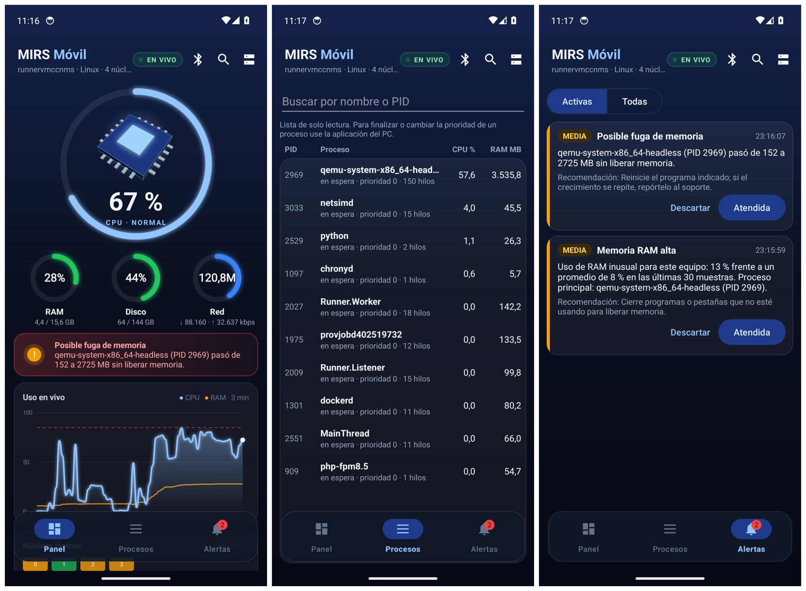

# Evidencias de la Fase II

Capturas reales de la app MIRS Móvil ejecutada en un emulador de Android 14 (API 34, perfil Pixel 6), conectada al servidor de MIRS por `http://10.0.2.2:8765`. Las tomó el flujo [App Android (APK y capturas)](../.github/workflows/app-android.yml), que compila el APK, lo instala, abre la app y recorre sus pantallas con `adb` (ejecución [43525485778](https://github.com/gustavo8015/MIRS_SISTEMASOPERATIVOS_G2/actions/runs/43525485778), 13 de noviembre de 2026).

| Archivo | Qué muestra |
|---|---|
| `app/01_panel.png` | Panel en vivo: estado EN VIVO, chip 3D, CPU total, anillos de RAM, disco y red, alerta destacada, gráfica de uso y núcleos |
| `app/03_procesos.png` | Procesos del equipo ordenados por consumo de CPU, con PID, estado, prioridad, hilos y memoria |
| `app/04_alertas.png` | Alertas generadas por el servidor (posible fuga de memoria y memoria RAM alta) con recomendación y acciones |
| `pruebas_unitarias.txt` | 38 pruebas automáticas del servidor que consulta la app, todas superadas |

Las alertas de las capturas no se forzaron: el servidor las detectó solo al ver crecer la memoria del proceso del emulador (`qemu-system-x86_64`) mientras arrancaba la app.
